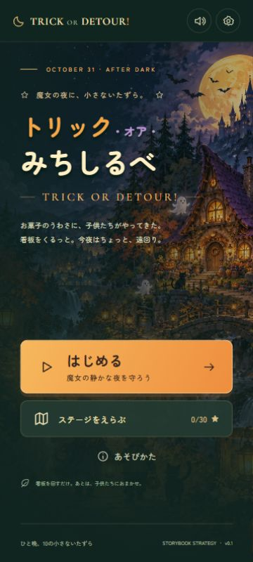

# トリック・オア・みちしるべ

**TRICK OR DETOUR!** — 魔女の静かな夜を守る、絵本風ハロウィン誘導ゲーム。

看板をタップして道を変え、仮装した子供たちを行き止まりへ。子供たちは一度迷った道を覚えています。おやつ好きにはお菓子を、緊急時にはおばけを使って、帰宅してもらいましょう。



## 遊ぶ・開発する

Node.js 24 LTS を推奨します。

```sh
npm ci
npm run dev
```

表示されたローカルURLをブラウザで開きます。開発サーバーは同じWi-Fiのスマートフォンでも表示されるNetwork URLから開けます。端末・Windowsのネットワーク設定によって接続可否は変わります。

```sh
npm run verify     # ルール・全ステージのクリア手順を検証してビルド
npm run build      # 静的配信用ファイルを dist/ に生成
npm run preview    # ビルドしたゲームをブラウザで確認
```

`dist/` は静的ホスティングで配信できます。相対パスのビルドなのでサブディレクトリにも配置できます。APIキー、バックエンド、アカウント登録は不要です。

## 操作

- 看板をクリック／タップ：時計回りに向きを変更。ゲーム中は同じ看板の操作は0.15秒間隔で反応します。
- お菓子／おばけ：ボタンを選び、光る配置ポイントをタップ。もう一度ボタンかEscでキャンセル。
- 最初は準備時間。地図と看板を確認して「森へご案内！」で開始。
- プレイ速度は初期設定0.7倍。画面下の「速度」で1倍に切替可能。Stage 005はいたずらっ子の入門に再調整。
- キーボード：1・2で看板、スペースで開始／ポーズ、Escでポーズ／ダイアログを閉じる。
- 設定：日本語・英語、効果音、音楽、演出の軽減。

子供の足元の丸は迷い値です。いっぱいになると入口へ帰ります。白い子は看板を信じ、紫の子はお菓子を優先し、緑の子は看板を勝手に回します。

## v0.1の内容

10ステージ、3マップ、子供3種類、看板・お菓子・おばけ、即時失敗判定、星評価、ステージ解放、記録保存、ポーズ、再挑戦、オリジナル合成SE/BGMを実装済みです。ステージ10にはかぼちゃ大王の演出があります。

星と設定はこのブラウザのlocalStorageに保存します。保存領域が利用できない場合もプレイできますが、記録は保持できません。別タブやアプリに移動すると自動でポーズします。

初期ステージは6〜18秒の短い導入です。後半の検証済みクリア手順は約21〜37秒。固定の登場間隔・通路時間・迷い耐性・到達許容数は仕様書に従っています。準備時間、迷い値の表示、キーボード操作は遊びやすさのために追加しました。

## 構成

| ファイル | 役割 |
| --- | --- |
| `src/engine.ts` | 描画に依存しない、60 tick/秒の決定論的シミュレーション |
| `src/stages.ts` | 3マップ・10ステージのデータ |
| `src/render.ts` | SVGの地図・看板・子供・演出 |
| `src/main.ts` | 画面遷移、入力、HUD、固定ステップ更新 |
| `src/save.ts` | 保存データの検証・復旧・ステージ解放 |
| `src/audio.ts` | 外部サンプルを使わないWeb Audio合成音 |
| `tests/` | ルール、保存、クリア手順、開発専用UI検証ページ |

SVG＋DOMを使う小さな構成です。提供されたMADOツール群は必要に応じて今後の素材制作・音作り・出荷工程で導入できます。現在のMVPは追加サービスなしで動作します。

## 検証・素材

- [MVP仕様書](docs/MVP-SPEC-v0.1.md)
- [検証記録とクリア手順](docs/VERIFICATION.md)
- [素材・利用条件](ASSETS.md)
- [ImageGenプロンプト](docs/imagegen-prompts.md)

30テスト、全ステージの星3つクリア手順、ブラウザの主要操作、360×800・720×1280・PC画面を検証済みです。Android実機・Safari・Firefoxの動作は未確認です。

素材のPNG原本は `art/source/`、ゲーム用のWebPとフォントは `public/assets/` に保存しています。画像の再圧縮は `node scripts/optimize-art.mjs`。日本語コピーを増やした時のフォント再生成手順は [素材一覧](ASSETS.md) にあります。
